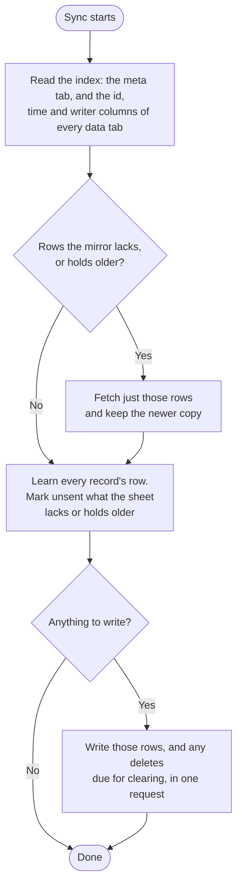
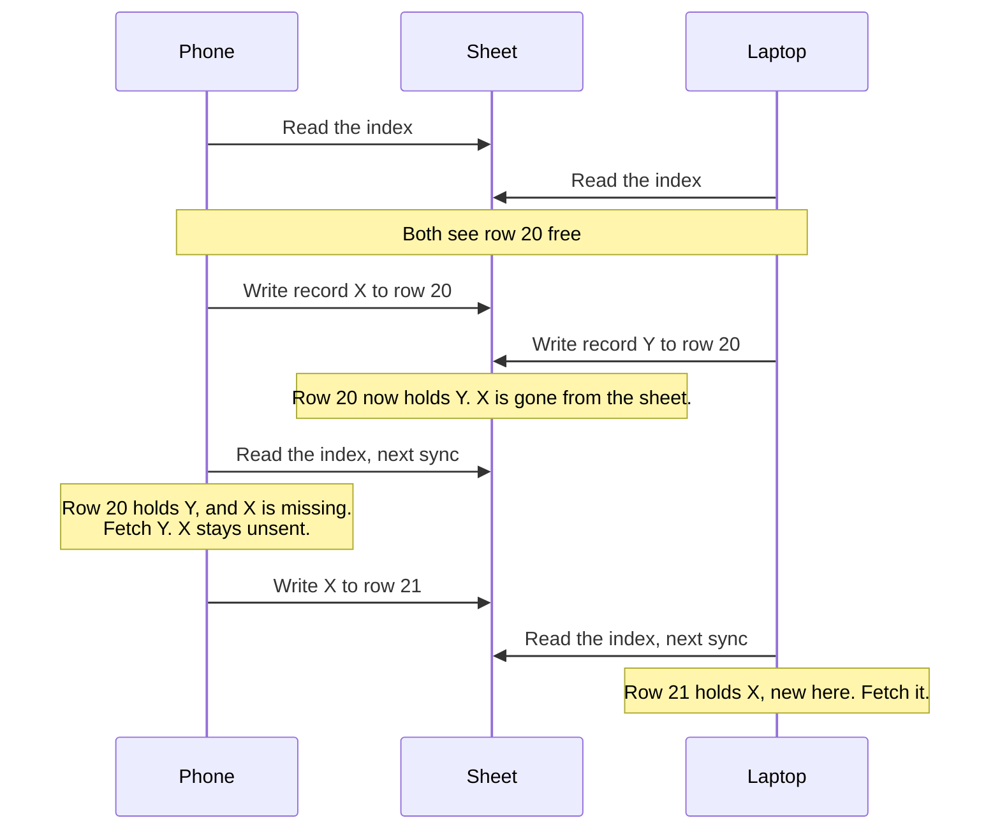

# Study space: bookmarks, read marks, highlights and notes — design

Started 2026-11-15 as the sync design. Rewritten 2026-11-17 to cover the whole
study space. Nothing is built.

**Status: draft.** The user's decisions are under *Decided* (Part 2).
Everything else is proposed. Calls made without the user are marked
*(my call)*.

Sources:

- The requirements document (Google Doc), §3 *Personal Study Space*.
- ADR-003, the prestudy (2026-10-09). It is kept outside this repo.
- tipitaka.lk's bookmarks: `web/src/stores/bookmarks.ts` in the local
  `tipitaka.lk-readonly` mirror.

# Part 1 — Functional

## Why

A person studies the canon over months. They mark what matters, write what
they understood, link passages across the Tipiṭaka, and keep track of what
they have read.

- **The work is theirs.** It lives in a Google Sheet in their own Drive,
  readable without the app, and it outlives the app.
- **It follows them.** Phone and laptop show the same marks within a minute or
  so.
- **It shows the work.** A few months in, the sheet should make the person feel
  good about what they have done: how much they read, highlighted and wrote.
  Not just a pile of rows.

## Bookmarks

- **One place: a sutta, or one paragraph.** Never a run of paragraphs. Like
  tipitaka.lk's star: tap to add, tap again to remove.
- **In the reader's selection menu**, *Bookmark* shows only while the selection
  sits inside one paragraph. *(my call)*
- **One bookmark per place.** Bookmarking the same place on two devices makes
  one bookmark, not two.

## Read and Read later

- **One state per sutta:** *Read later*, *Read*, or neither. Not a log: reading
  a sutta again adds nothing.
- **Read later is a short-lived queue.** Marking a sutta *Read* takes it off.
- **The date the state was set is kept**, so the sheet can say "read this
  month".
- **Listed in the study area**, not marked in the tree.

## Highlights

- **One paragraph, or several in the same sutta.** Never across suttas. Select
  across the paragraphs and choose *Highlight*: every paragraph the selection
  touches is highlighted. *Highlight* shows only while the selection stays
  inside one sutta. *(my call)*
- **A paragraph is the Pali and its Sinhala together.** The mark shows in every
  reading layout, the way Bible apps mark a verse in every translation.
  *(my call)*
- **One colour:** the requirements' mint green, "you did this". More colours
  could come later.
- **A highlight can have a note.** *Add note* on a highlight starts a note that
  links that passage. Deleting the highlight keeps the note.
- **Later: any words inside a paragraph.** The data already holds it (see
  *A place in the text*). Flutter 3.44 reports which characters of each
  paragraph a selection covers, and the in-page search already paints part of
  a paragraph, so it is a smaller step than it looks.

## Notes

- **Text the person writes, with links into the canon.** A note can link
  nothing (a free note), a sutta, a passage, or any mix of suttas and passages
  across the Tipiṭaka. Each link is one sutta, or one passage: one paragraph or
  several in the same sutta.
- **`@` links a sutta.** Typing `@` opens a search of sutta names. Picking one
  puts a link in the text, drawn as a chip. Notion does the same with `@`,
  Obsidian with `[[`.
- **A note is never restricted; only where it starts from may be.** From the
  reader: select one or more paragraphs of a sutta, then *Add to note…*, then a
  new note or an existing one. The link goes at the end. Like *Highlight*, it
  shows only while the selection stays inside one sutta. From the note's own
  view, links to any number of suttas and passages can be added at any time.
- **The first line is the title**, as in Apple Notes. *(my call)*
- **Labels** (P3): a note can carry labels, picked from those already used or
  typed new.
- **In the reader**, a paragraph or sutta that a note links shows a small mark.
  Tapping it opens the note.
- Deleting a note doesn't touch highlights.

## In the app

- **The study area**, a tab of its own in the app (the user's plan): Notes,
  Highlights, Bookmarks, Read later and Read, and a sync line (last synced,
  changes not yet sent). Designed separately.
- **Settings:** connect and disconnect Google.
- **Everything works before Google is connected.**

## The sheet

Made in the person's Drive when they connect Google, named
"Sammaditthi - Notes".

- **Readable tabs**, built by formulas from the data: Overview, Notes,
  Highlights, Bookmarks, Reading. Newest first, deleted items left out, headers
  in the app's language.
- **Data tabs**, hidden, one per kind of record. The app owns them. Editing one
  by hand shows a warning.
- **Every row shows** the date, the sutta's name, where it sits in the canon,
  the words, and two links: sammaditthi.net and tipitaka.lk. If both sites ever
  go away, the words are still there.
- **People can add their own tabs**, charts or colours. The app never touches a
  tab it didn't make. It may rebuild its readable tabs at any time, since they
  hold only formulas.

The Overview, roughly (numbers made up):

```
                    All time   This month
Suttas read            42           6
Highlights            118          14
Notes                  23           3
Bookmarks              31           2

Read by book:  දික් සඟිය 9 · මැදුම් සඟිය 21 · සංයුත්ත නිකාය 12
```

The Highlights tab, roughly:

| Date | Sutta | Book | Words | Links |
|---|---|---|---|---|
| 2026-11-17 | බ්‍රහ්මජාල සූත්‍රය | දික් සඟිය | එවං මෙ සුතං… | sammaditthi.net · tipitaka.lk |

## Phases

The requirements' priorities in brackets.

- **Before phase 1:** spikes S2 and S3, and the rerun of the sync simulation
  (see *Still open*).
- **Phase 1, sync and bookmarks** (P1): `notes.db`, connecting Google, the
  sheet, the sync, sutta and paragraph bookmarks, and the study area with
  Bookmarks and the sync line. The reader's selection menu (today Copy and a
  placeholder More, `reader_selection_handler.dart`) gains *Bookmark*.
- **Phase 2, read marks and highlights** (P2): Read and Read later, highlights
  over one or more paragraphs, the study area's other lists, the Overview.
- **Phase 3, notes** (P3): notes, `@` links, *Add to note…*, the reader's note
  marks, labels.
- **Later:** highlights of any words, colours, goals and progress (P4), places
  in other editions.

# Part 2 — Technical

## Decided

By the user, 2026-11-15:

- **The Google Sheet in the person's own Drive is the database.** It is not a
  backup.
- **Each device keeps a full mirror** in its own Drift database. The app only
  ever reads and writes the mirror, so everything works offline.
- **Sync copies changes both ways the moment it can.** A delay of a minute or
  so is fine, because people rarely switch devices.
- **Use first, connect later.** Everything works before Google is connected.
  Connecting sends it up.
- **The sync stays super simple.** No conflict screen, no merging of two edits
  to one note, no special-case handling.

By the user, 2026-11-17:

- **A bookmark marks one place:** a sutta, or one paragraph.
- **A highlight is one paragraph or several in the same sutta**, never across
  suttas. Any words later, if the data allows it cheaply.
- **A note is never restricted; only where it starts from may be.** A note
  started from a highlight, or from a selection, links that one passage. More
  suttas and passages can be added from the note's own view.
- **Deleting a highlight keeps its note.**
- **Read marks are a state, not a log.** Read later is short-lived. No ticks in
  the tree: the study area, a tab of its own, lists them.
- **The readable tabs are separate from the data**, and the data tabs are
  hidden.
- **A note's links live in its text**, not in rows of their own.
- **The light sync.** How a sync learns what changed stays open between two
  ways, to decide during implementation (*Two ways to learn what changed*).
- **Clearing old deletes after 90 days**, in the app, is the answer for now. A
  better way can replace it.
- **The device's database is `notes.db`.** An old local database is deleted
  only when nothing unsent is left.
- **The sheet is named "Sammaditthi - Notes".**

ADR-003 words it the other way round ("Drift is the source of truth, sync is
optional"). Its mechanics still apply. Only its wording needs updating.

## `notes.db`

- **Its own file**, with real tables and Drift migrations. The content
  databases (`bjt.db`, `dict.db`) are read-only copies that the installer
  replaces on every update. `notes.db` is never one of them.
- **Native:** the app's support folder, on every platform. Never the cache
  folder the content databases use outside Android, which the OS may clear.
- **Web:** OPFS, named `notes`. The installer only deletes old versions of
  `bjt-…` and `dict-…`.
- **Layers as elsewhere:** Freezed entities (`Bookmark`, `ReadMark`,
  `Highlight`, `Note`, and `TextPlace` for a place in the text) and a
  repository interface in `domain/`. The Drift tables, the sheet data source
  and the sync in `data/`.

## A place in the text

Bookmarks, highlights and note links all point at a place. One place is:

| Part | Holds | Example |
|---|---|---|
| `nodeKey` | The sutta (tree node). | `dn-1-1` |
| `from` | First paragraph, as `page.entry`: the page in the file and the paragraph on it, counted from 0. The same numbers as `?e=` and tipitaka.lk's links. Blank for the whole sutta. | `0.6` |
| `to` | Last paragraph. Same as `from` for one paragraph. | `0.8` |
| `lang` | The language of `words`, `pi` or `si`: the side the selection was made on. | `pi` |
| `words` | The passage's words, cut at 500 characters. *(my call)* | `එවං මෙ සුතං…` |
| `canon` | The canon text version the place was last checked against: `synced_on` from `scripts/bjt-sync-regen/bjt-provenance.json`. | `2026-10-19` |

- **Why the words.** BJT has no fixed paragraph ids (ours, `segmentId`, are
  counted when a file loads), and a canon sync can shift `page.entry`.
  tipitaka.lk hit the same problem, and its bookmarks keep the paragraph's
  text. The words also make the sheet readable on its own.
- **Any words later**, with no new column: `from` and `to` take a character
  offset, as in `0.6:37`. Such a mark shows on the `lang` side only.
- **Other editions later.** A blank edition means BJT. A later edition adds an
  `edition` column, and its `from` and `to` hold its own ids (SuttaCentral's
  segment ids).
- **The app has to ship the canon version.** Today `bjt-provenance.json` only
  sits next to the sync script.

### Finding a place again

After a canon update:

1. **Before showing a place**, check that the paragraph at `from` starts with
   the saved words, ignoring spaces, punctuation and joiners.
2. **If not**, look for the words in the same sutta, then in the same file.
   Found once: show it there, and move `to` by the same amount.
3. **Not found:** show the saved words with "this passage may have moved".
   Never a guessed paragraph.

Only a device whose canon is newer than the row's `canon` saves the fix, and
sets `canon` to its own. A device with older text only looks. So two devices
on different canon versions never undo each other's fixes.

A whole-sutta place has only its `nodeKey`. If a canon sync renames the key,
the saved sutta name finds it (see *Still open*).

### Ids

- **Highlights and notes:** a random id each.
- **Bookmarks and read marks:** an id made from the place: `dn-1-1` for a
  sutta, `dn-1-1@0.6` for a paragraph. *(my call)* They are the state of a
  place, so two devices that bookmark the same place offline make the same
  record, and removing it on one removes it everywhere.
- A place that moves keeps its id. The app finds a bookmark by its place, not
  by its id.

## The sheet's tabs

| Tab | Written by | Holds |
|---|---|---|
| Overview | formulas | Totals, this month, by month, read by book |
| Notes, Highlights, Bookmarks, Reading | formulas | The readable lists |
| `_notes`, `_highlights`, `_bookmarks`, `_reading` | the app | One row per record. Hidden, with Google's edit warning |
| `_meta` | the app | The layout version, and the clearing date (see *Clearing old deletes*) |

### Data columns

Every data tab starts with ADR-003's four columns:
`id | updatedAt | writer | deleted`. `updatedAt` is a whole number
(milliseconds), `writer` the device's id, `deleted` either `TRUE` or blank.

Then, per tab:

| Tab | The record | For people (written, never read back) |
|---|---|---|
| `_bookmarks` | `created`, the place without `to` | `sutta`, `path`, `book`, `link`, `tipitaka.lk` |
| `_reading` | `nodeKey`, `status` (`read` or `later`), `since`, `canon` | `sutta`, `path`, `book`, `link`, `tipitaka.lk` |
| `_highlights` | `created`, the place | `sutta`, `path`, `book`, `link`, `tipitaka.lk` |
| `_notes` | `created`, `body`, `labels` (one per line), `canon` | `title`, `suttas` (one per line), `links` |

- **Dates people read** (`created`, `since`) are real sheet dates, so formulas
  can group them by month.
- **`book`** is the nikāya or book the sutta belongs to, for "read by book".
  **`path`** is the tree path above the sutta.
- **The readable tabs** are `QUERY` or `FILTER` formulas over these columns
  that skip blank and deleted rows.

### Links

- **`link`:** `https://sammaditthi.net/tipitaka/<key>?e=<from>`, built with
  `SitePlan.servingLink`, which adds `#<leaf>` for a folded leaf. The public
  site opens the sutta. The app, once app links are live, opens the paragraph
  (`docs/todo/web-strategy/deep-linking-and-shareable-urls.md`).
- **`tipitaka.lk`:** `https://tipitaka.lk/<nodeKey>/<page>-<entry>/<pali|sinh>`,
  or `https://tipitaka.lk/<nodeKey>` for a sutta. It doesn't depend on this
  project.

### Limits

- **A cell holds at most 50,000 characters**, so a note's text stops at 45,000.
  *(my call)*
- **A spreadsheet holds at most 10 million cells**, blank ones included. Not a
  concern at this size.

## A note's text

Plain text. Line breaks are kept. A link is written the Markdown way:

```
Sīla first, then samādhi.
[බ්‍රහ්මජාල සූත්‍රය](https://sammaditthi.net/tipitaka/dn-1-1?e=0.6&to=0.8 "එවං මෙ සුතං…")
Compare [සාමඤ්ඤඵල සූත්‍රය](https://sammaditthi.net/tipitaka/dn-1-2)
```

- **The label** is what the chip shows: the sutta's name.
- **The URL** is the place, in the public link grammar. `to` is a new optional
  parameter for a range. *(my call)* Today's parser ignores it, so an older
  app opens the first paragraph.
- **The title in quotes** holds the first words, for *Finding a place again*.
  A sutta link has neither `?e=` nor a title.
- **The row's `canon`** covers every link in the note.
- **The people columns** `title`, `suttas` and `links` are worked out from the
  text each time the note is saved.
- **The reader's note marks** come from a table in `notes.db` (note id to
  place), rebuilt from the text whenever a note is saved or arrives from the
  sheet. It is never synced.
- **Pasted into Obsidian** or any Markdown editor, the note keeps working
  links.

## The light sync

### What each side keeps

**The sheet:** the tabs above.

**The device mirror:**

- The same records.
- Per record, `unsent`: the sheet hasn't been seen holding this version yet.
- Per record, `sheetRow`: the row it sits on in the sheet. Empty until known.

"Newer" means the higher `(updatedAt, writer)` pair, as in ADR-003.

### One sync pass

Written out with way A, *read the index*. Way B changes only steps 1 and 2
(*Two ways to learn what changed*).



1. **Read the index:** the `_meta` tab and the `id`, `updatedAt` and `writer`
   columns of every data tab, in one request. It says what the sheet holds, at
   which version, and on which row. A layout newer than this app knows stops
   the sync here (*A newer app on another device changes the sheet*).
2. **Fetch only the rows that are new here, or newer than the mirror's copy**,
   in one request, and keep the newer copy of each.
3. **Compare the index with the mirror:**
   - Learn every record's row.
   - A record the sheet holds at this version: clear `unsent`.
   - A record the sheet lacks, or holds older: mark it `unsent`. There is one
     exception (*Clearing old deletes*).
   - The same id on two rows: blank the older row (*Repair*).
4. **Write** the unsent rows in one request: each to its own row, a new one to
   the first blank row or under the last. Deletes due for clearing go in the
   same request.

A first sync knows no rows, so every record the mirror holds is unsent. That
is also how "use first, connect later" works.

A sync that fails (offline, or an error from Google) changes nothing and waits
for the next trigger.

```dart
Future<void> syncOnce() async {
  // 1. One request: the meta tab, plus the id, updatedAt and writer columns
  //    of every data tab. It says what the sheet holds, and on which row.
  final index = await sheetApi.readIndex();

  // 2. Fetch only the rows that are new here, or newer than our copy.
  final wanted = await db.rowsToFetch(index);
  if (wanted.isNotEmpty) {
    await db.mergeIn(await sheetApi.readRows(wanted)); // the newer copy wins
  }

  // 3. Learn every row, clear "unsent" for what the sheet holds,
  //    and mark "unsent" what it lacks or holds older.
  await db.compareWith(index);

  // 4. One request: the unsent rows, plus any deletes due for clearing.
  final toWrite = await db.rowsToWrite();
  if (toWrite.isNotEmpty) await sheetApi.writeRows(toWrite);
}
```

### Two ways to learn what changed

Left open, to decide during implementation (the user, 2026-11-17).

- **A: read the index**, as written out above. Every sync reads the `id`,
  `updatedAt` and `writer` columns of every data tab, then fetches only the
  rows that changed.
- **B: a stamp per device.** `_meta` holds one stamp cell per device. A device
  writes only its own, with a new random value each time it writes. A sync
  first reads `_meta`, plus the `id` and `updatedAt` cells of the rows this
  device wrote last time (to confirm them) and of the rows it is about to
  write (to check they still hold what it expects). If another device's stamp
  moved, or a checked row holds something else, it downloads every tab and
  merges. Otherwise it goes straight to the write.

Both notice rows sorted by hand before writing to them. They differ in weight
(*Weight*): A reads more on every sync, B downloads far more whenever another
device has written.

### When it runs

As in ADR-003: on app start and resume, about 30 seconds after the last edit,
and from a "Sync now" button. One sync at a time per device, and on web one
across all tabs.

### Two devices write at the same moment



No code handles this case. The next read shows X missing, and rule 2 sends it
again. An app killed in the middle of a sync heals the same way. With way B,
the phone's next sync sees the laptop's stamp moved, downloads everything, and
X heals the same way.

### Rules it can't drop

1. **A delete is a flag on the row** (`deleted`), with the content blanked. The
   row stays until it is cleared.
2. **Missing from the sheet, or older there, means "not sent yet"**, never
   "deleted". The one exception is a cleared delete.
3. **Each edit is stamped later than the version it replaces**:
   `updatedAt = max(now, old + 1)`. A wrong device clock then can't make an
   edit lose to the version the person was looking at.
4. **Rows never move.** Nothing sorts, inserts or removes rows. Repair and
   clearing blank a row where it is.
5. **A record stays unsent until a read shows the sheet holding it.** A write
   that seemed to work but didn't is simply sent again.

The prestudy's simulation removed rules 2 and 3 in turn and lost data in most
runs. Rule 1 is what makes rule 2 possible. Rules 4 and 5, and the clearing,
are new with this design.

### Repair

If the index shows the same id on two rows, the app keeps the row with the
newer copy and blanks the other. Rows don't move, so no device's row numbers
go wrong.

### Clearing old deletes

A deleted record stays as a blank row with only its id, time and delete flag,
so every device learns of the delete. After 90 days that job is done. This is
the answer for now (the user, 2026-11-17), and a better way can replace it. It
runs in the app, like the rest of the sync: there is no server.

- **Any device, in its normal write, blanks those rows completely**, and sets
  the clearing date in `_meta` to the cut-off.
- **A fully blank row is free.** The next new record goes there instead of
  under the last row, so the sheet stays about as long as its live records.
- **The one exception to rule 2:** a record that isn't marked `unsent` (so
  this device has seen it in the sheet), last changed before the clearing date,
  and that the sheet now lacks, was deleted elsewhere and cleared. This device
  drops it instead of sending it again. An `unsent` record is always sent.
- **The side effect:** an edit left unsent for more than 90 days can bring back
  something deleted on another device in that time.

Why 90 days, not "once every device has seen it": a phone that is lost, or
never opened again, would block clearing forever.

**If clearing ships after the first release that syncs**, it has to come with a
layout version bump. An older app doesn't know the exception to rule 2 and
would send cleared items back. The bump makes it stop syncing instead
(*A newer app on another device changes the sheet*).

### Hand edits

The data tabs are hidden and warn before any edit, and the readable tabs are
where people look. Still:

- **Sorting rows by hand** does no harm. The next sync notices before it
  writes, and relearns where each record sits.
- **Deleting a row by hand** isn't supported. A recent record comes back. One
  older than the clearing date stays deleted.
- **Editing a cell by hand** isn't seen by the app, and is overwritten the next
  time the app writes that row.

### Left out on purpose

- **The same record edited on two devices before either syncs.** The later
  edit wins and the other is dropped. No merging, no prompt.
- **Realtime.** Changes arrive within a minute or so.

### Weight

| | Whole-sheet sync (ADR-003) | Light sync, way A | Light sync, way B |
|---|---|---|---|
| App opens, nothing new | downloads the whole sheet | reads the index | reads a few cells |
| After adding a bookmark | downloads and uploads the whole sheet | reads the index, uploads one row | reads a few cells, uploads one row |
| Another device added something | downloads the whole sheet | reads the index, downloads those rows | reads a few cells, downloads the whole sheet |

- **The index** is about 80 bytes per record, so roughly 160 KB for 2,000
  records before compression. An estimate, not a measurement.
- **The whole sheet**, for 2,000 highlights and notes in Sinhala, comes to a
  few megabytes. Google recommends keeping a request under about 2 MB
  (ADR-003).
- **A sync makes at most three requests.** Google allows 60 reads and 60
  writes a minute per user.

### What it costs

- **More code** than the whole-sheet version.
- **The proof has to be redone.** The prestudy's simulation (S1) covered
  whole-sheet writes only. It has to be extended to this way of writing, with
  the clearing, and rerun with its negative controls before any screen is
  built on it.

## When something updates under unsent rows

The user's rule: **an old local database is deleted only when nothing unsent is
left.**

### New canon text

The installer replaces `bjt.db` and deletes the old copy. That never touches
`notes.db` (see *`notes.db`*). Unsent rows stay unsent and go up on the next
sync. Saved places are checked against their words (*Finding a place again*).

### A new app version changes `notes.db`'s tables

- **A Drift migration, in place, in one transaction.** A migration that fails
  leaves the old tables as they were.
- **Before it runs, the file is copied aside.** The copy is deleted after the
  first sync that leaves nothing unsent. A device that never connects Google
  keeps its copies: a few small files over the app's life.

### A newer app on another device changes the sheet

- **`_meta` holds the layout version.** A layout change only adds tabs, or
  columns on the right. Nothing is renamed, moved or removed.
- **An app that finds a newer layout than it knows stops syncing** and asks to
  be updated. It keeps working offline, and its unsent rows wait in
  `notes.db`.
- **The first updated app to sync** adds the new columns and raises the version
  in the same write.

## Sign-in and privacy

- **Sign-in asks only for `drive.file`.** The app can open only files it
  created, and sees nothing else in the person's Drive. Google rates this scope
  non-sensitive and recommends it.
- **No server of ours sees the data.** Devices talk to Google directly.
- **Not encrypted.** It is the person's own Drive, and an encrypted sheet would
  be unreadable, which defeats it.
- **Google keeps the sheet's version history** (File → Version history): a free
  undo for any mistake.
- **Disconnecting** keeps this device's copy and its unsent marks.

## Ways considered

**The sync**

- **Whole copy, newest wins.** The last device to sync overwrites the sheet.
  Least code, but it loses data in ordinary use: bookmark on the phone offline,
  bookmark something else on the laptop, and one of the two disappears.
- **Whole-sheet merge** (ADR-003, as tested). Read everything, merge record by
  record, write everything. Simple and proven, but every sync moves the whole
  sheet: megabytes for one bookmark on a phone.
- **Write only today's rows.** A date is the wrong test: a device that was
  offline yesterday would never send yesterday's rows. `unsent` replaces it.
- **One stamp cell** (the first light-sync draft). A device read one cell to
  learn whether anyone had written. Two devices writing at once could leave one
  of them never learning of the other's write. Both ways in
  *Two ways to learn what changed* fix it.
- **Removing cleared rows.** Deleting a row shifts every row below it, and
  every device's row numbers go wrong. Blanking in place replaces it.
- **Clearing a delete once every device has seen it.** Exact, but a lost phone
  blocks clearing forever. The 90 days replace it.

**The data**

- **A note's links as rows of their own** (a Connections tab). Structured, but
  under newest-wins a note and its links can drift apart: one device edits the
  note while another removes a link. And the note's text alone wouldn't say
  what it links.
- **Fixed paragraph ids.** BJT has none, and a hash of the paragraph's text
  breaks on any typo fix. The saved words replace them.
- **A log of reads.** Not wanted. One state per sutta.

## Still open

- **Spike S2 blocks everything:** can one platform's build find a sheet that
  another platform's build created? It needs the Google Cloud project, which is
  the user's to set up.
- **Spike S3:** Windows sign-in.
- **Extend and rerun the simulation.** The script (`spikes/sync_sim.py`) lives
  with the prestudy, outside this repo.
- **Web, two tabs writing `notes.db`.** The content databases open with drift's
  `opfsLocks` mode. Check that it is safe for writes from two tabs; if not,
  pick another mode or let one tab own the writes. Also ask the browser to keep
  the site's storage (`navigator.storage.persist`), or it may evict `notes.db`.
- **Renamed nodeKeys.** A rename list (old key to new) from the canon sync would
  fix shared links and saved places together
  (`docs/todo/canon-sources/bjt-sync-regen.md`, step 3). Until then a renamed
  sutta is found by its saved name.
- **The sheet trashed in Drive.** Make a new one from this device's copy, or
  disconnect? Ask the person.
- **Switching Google accounts** with data on the device.
- **The screens:** the study area, the reader's marks and menus, the note
  editor. A separate piece.
- **"How much of each book I've read"** on the Overview needs each book's sutta
  count. The app could keep it in a hidden tab.
- **ADR-003's wording**, see *Decided*.
- **Way A or way B** for learning what changed, decided during implementation.
- **The user's go-ahead** on the calls marked *(my call)*.

## Left to the builder

- Run the merge in one database transaction.
- Save a new record's chosen row before writing it, so a retried write lands on
  the same row.
- Make sure the sheet has rows to take new records.
- Fetch changed rows in as few ranges as possible. When many changed, fetch the
  whole tab.
- Ask Google for compressed responses.
- One sync at a time per device. On web, a Web Lock across tabs, as the
  installer uses.
- **Which paragraphs a selection covers:** wrap each paragraph in a
  `SelectionListener` (Flutter 3.44). Its range also gives the character
  offsets for any-words highlights. Map those from the rendered text to the
  plain text.
- Part-paragraph marks: reuse the in-page search's painting.
- The device id stays out of the OS backup. A restored phone is a new device.
- Connecting and disconnecting Google.
